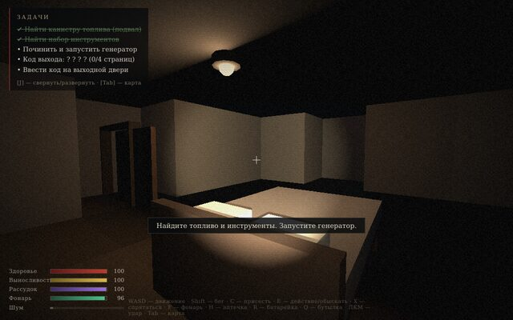
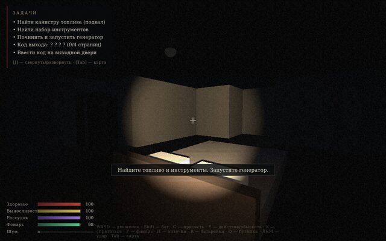
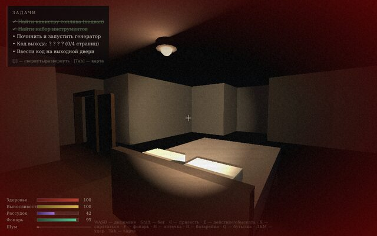
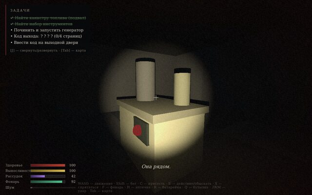

# 🕯 Кошмарный дом — The Nightmare House

3D-хоррор от первого лица: **Granny + Slender Man** в одном доме.
Чистый JavaScript + WebGL, **ни одного внешнего ресурса** — в самой игре нет ни картинок,
ни звуковых файлов, ни готовых моделей: всё генерируется кодом прямо во время игры.
(Изображения ниже — только документация, снятая с работающей игры.)

```
Открыть index.html  →  играть
```




| Тьма и фонарь | Бабушка | Подвал с генератором |
| --- | --- | --- |
|  |  |  |

*(Скриншоты сняты автоматически в headless-браузере на программном рендере —
на реальной видеокарте картинка заметно плавнее и детальнее.)*

---

## 🚀 Запуск

Игра — обычная страница, никакой сборки не нужно.

* **Вариант 1.** Откройте `index.html` двойным кликом (работает по `file://`).
* **Вариант 2.** Любой статический сервер:
  ```bash
  python3 -m http.server 8123
  # затем http://localhost:8123
  ```
* **Вариант 3.** Опубликуйте папку на любом хостинге статики (GitHub Pages и т.п.).

Требуется любой современный браузер с WebGL (Chrome, Firefox, Edge, Safari 15+).

---

## 🎯 Как играть

Цель — **выбраться из дома**.

1. **Найдите канистру топлива** (она в подвале) и **набор инструментов** (где-то наверху).
2. **Почините и запустите генератор** в подвале. После этого в доме появится свет
   и заработает кодовый замок. Но генератор — источник шума: он позовёт всех.
3. **Соберите 4 страницы дневника** — на каждой одна цифра кода выходной двери.
   Читать страницы — вредно для рассудка.
4. **Введите код** на двери в холле и сбегите.

### Управление

| Клавиша | Действие |
|---|---|
| `W` `A` `S` `D` | движение |
| `Shift` | бег (громко, привлекает врагов) |
| `C` | присесть (тихо, медленно) |
| `E` | действие / обыскать (держать) / закрыть-открыть дверь |
| `X` | спрятаться в шкаф, бочку, под кровать |
| `F` | фонарь (включить/выключить) |
| `H` | аптечка | 
| `R` | заменить батарейку |
| `Q` | бросить бутылку (отвлечь) |
| ЛКМ | ударить железной трубой |
| `Tab` | карта дома |
| `J` | свернуть/развернуть список задач |
| `Esc` | пауза |

### Что важно знать

* **Рассудок** падает в темноте, рядом со Слендером и от страшных находок.
  На низком рассудке начинаются галлюцинации, шёпоты и обмороки.
* **Выносливость** кончается от бега — потом вы тяжело дышите и шумите.
* **Фонарь** садится. Батарейки лежат в ящиках.
* **Шум** — ваш главный враг. Спринт, выстрел двери, разбитая бутылка, генератор —
  всё это слышно. Мясник охотится только на слух.
* **Закрытые двери** задерживают Бабушку, но она их открывает.

---

## 👹 Кто живёт в доме

| | Кто | Как охотится | Как выжить |
|---|---|---|---|
| 👵 | **Бабушка** | Слышит шаги и шум, идёт по последнему звуку, открывает двери, прячется в шкафах и ждёт | Беги, закрывай двери, прячься; труба оглушает её на пару секунд |
| 🕴 | **Слендер** | Появляется из ниоткуда рядом, замирает под вашим взглядом, крадёт рассудок | Смотрите на него — он замерёт; свет в глаза отпугивает; не смотрите — уходите |
| 🔪 | **Мясник** | Слепой. Идёт на звук, разбегается и бьёт | Не бегите, отвлекайте бутылками, бейте трубой — оглушится на 9 секунд |
| 🧸 | **Кукла** | Ползёт только пока вы на неё **не смотрите** | Смотрите — она стоит; направьте фонарь — сгорит |

Подробное описание ИИ — в [`docs/AI.md`](docs/AI.md).

---

## 🧩 Что внутри

* **Процедурный дом.** BSP-разбиение на 12–20 комнат, коридоры шириной в две клетки,
  двери, окна, **два этажа** (главный + подвал с лестницей), десятки видов мебели,
  шкафы-контейнеры, места для укрытий, лампы с мерцанием.
* **Процедурный звук.** WebAudio: шаги, скрип дверей, сердцебиение, дыхание,
  рык Бабушки, смех куклы, гул генератора, музыкальный дрон, который густеет
  вместе с опасностью.
* **Процедурная графика.** Вся геометрия собирается из примитивов и мержатся
  в несколько батчей, чтобы держать 60 fps: десятки тысяч треугольников, один
  материал на комнату.
* **Реалистичное восприятие ИИ.** Зрение (конус + линия видимости + свет),
  слух (радиус + затухание за стенами), память о последней позиции,
  A*-навигация по сетке, обход дверей, умение прятаться.

---

## ⚙️ Настройки

В меню: сложность (**Бабушка** / **Кошмар** / **Безумие**), чувствительность мыши,
громкость, поле зрения, качество (низкое/среднее/высокое — влияет на тени и
плотность тумана). Настройки сохраняются в `localStorage`.

---

## 📁 Структура

```
index.html          — разметка, экраны, HUD
styles/main.css     — оформление интерфейса
vendor/three.min.js — Three.js r160 (UMD, локально, без CDN)
src/util.js         — математика, ГПСЧ, куча для A*
src/meshes.js       — сборка геометрии из примитивов (мердж)
src/audio.js        — процедурный звук на WebAudio
src/nav.js          — сетка проходимости, A*, линия видимости
src/world.js        — генерация дома, мебель, двери, предметы, свет
src/player.js       — игрок: движение, фонарь, рассудок, укрытия
src/enemies.js      — Бабушка, Слендер, Мясник, Кукла и их ИИ
src/ui.js           — HUD, меню, миникарта, записки, кодовый замок
src/game.js         — цикл игры, цели, взаимодействия, смерть и победа
docs/AI.md          — как думают монстры
docs/screenshots/   — скриншоты для этой документации
```

---

## 📜 Лицензия

Код игры — ваш, делайте с ним что хотите.
`vendor/three.min.js` — Three.js © 2010–2023 three.js authors, лицензия MIT.
